<div align="center">

# Quantitative Comparative Analysis of Feature Extraction Methods in Computer Vision
### Academic Research & Benchmark Evaluation: Raw Pixels vs. HOG vs. Multi-Scale Spatial LBP

[](https://www.python.org/)
[](https://scikit-learn.org/)
[](https://opencv.org/)
[](https://www.tensorflow.org/)
[](LICENSE)

<br/>

[](README_TR.md)

<p align="center">
  <b>Author:</b> Ersin Sandal &nbsp;|&nbsp; <b>Academic Context:</b> Undergraduate Computer Vision Course Project
</p>

---

</div>

> [!NOTE]
> **Language Toggle / Dil Seçimi:**  
> Türkçe dokümantasyona ulaşmak için yukarıdaki kırmızı butona veya [buraya (README_TR.md)](README_TR.md) tıklayabilirsiniz.

---

## 📑 Table of Contents

- [1. Executive Summary](#1-executive-summary)
- [2. Research Problem & Theoretical Motivation](#2-research-problem--theoretical-motivation)
  - [2.1 The Core Scientific Question](#21-the-core-scientific-question)
  - [2.2 Methodological Rigor: Controlled Evaluation Setup](#22-methodological-rigor-controlled-evaluation-setup)
  - [2.3 Why Not Convolutional Neural Networks (CNNs)?](#23-why-not-convolutional-neural-networks-cnns)
- [3. Feature Extraction Methodologies](#3-feature-extraction-methodologies)
  - [3.1 Baseline: Normalized Raw Pixel Representation](#31-baseline-normalized-raw-pixel-representation)
  - [3.2 Histogram of Oriented Gradients (HOG)](#32-histogram-of-oriented-gradients-hog)
  - [3.3 Multi-Scale Spatial Local Binary Patterns (MS-S-LBP)](#33-multi-scale-spatial-local-binary-patterns-ms-s-lbp)
- [4. Benchmark Datasets](#4-benchmark-datasets)
  - [4.1 Fashion-MNIST (Shape-Centric)](#41-fashion-mnist-shape-centric)
  - [4.2 CIFAR-10 (Complex Natural Scenes)](#42-cifar-10-complex-natural-scenes)
  - [4.3 KTH-TIPS (Texture-Centric)](#43-kth-tips-texture-centric)
- [5. System Architecture & Experimental Pipeline](#5-system-architecture--experimental-pipeline)
- [6. Quantitative Results & Comparative Analysis](#6-quantitative-results--comparative-analysis)
  - [6.1 Consolidated Benchmark Results](#61-consolidated-benchmark-results)
  - [6.2 Fashion-MNIST Performance & Error Analysis](#62-fashion-mnist-performance--error-analysis)
  - [6.3 CIFAR-10 Performance & Error Analysis](#63-cifar-10-performance--error-analysis)
  - [6.4 KTH-TIPS Performance & Error Analysis](#64-kth-tips-performance--error-analysis)
- [7. Dimensionality vs. Performance Trade-off](#7-dimensionality-vs-performance-trade-off)
- [8. Hypotheses vs. Empirical Findings](#8-hypotheses-vs-empirical-findings)
- [9. Conclusions & Future Directions](#9-conclusions--future-directions)
- [10. Repository Structure](#10-repository-structure)
- [11. Installation & Reproduction Guide](#11-installation--reproduction-guide)
- [12. Academic Citation & License](#12-academic-citation--license)

---

## 1. Executive Summary

In classical and modern computer vision, transforming high-dimensional visual sensory data into informative, robust, and discriminative numerical representations is the primary determinant of downstream classification performance. This study presents a **quantitative, empirical comparative evaluation** of three fundamental feature representations:

1. **Normalized Raw Pixels** (Baseline reference without visual transformation)
2. **Histogram of Oriented Gradients (HOG)** (Contour, edge directionality, and shape descriptor)
3. **Multi-Scale Spatial Local Binary Patterns (MS-S-LBP)** (Hierarchical local texture and micro-structure descriptor)

To isolate the representational capacity of each feature extraction technique from classifier-induced variance, the classifier is held strictly constant as a **Linear Support Vector Machine (Linear SVM)** across all experiments. The benchmark evaluates these methods across three diverse computer vision datasets representing distinct morphological domains:
- **Fashion-MNIST** (Shape-dominant silhouettes)
- **CIFAR-10** (Complex natural images with significant background clutter)
- **KTH-TIPS** (Pure surface texture under varying illumination, pose, and scale)

### Key Empirical Findings:
- **No Universally Superior Handcrafted Descriptor:** There is no single feature extraction technique that consistently outperforms others across all visual domains. Optimal representation is strictly coupled to the underlying morphology of the dataset.
- **Shape Dominance:** On Fashion-MNIST, **HOG achieved the highest accuracy (85.80%)**, corroborating the hypothesis that edge orientation distributions are superior for structural silhouettes.
- **Texture Dominance & Dimensional Efficiency:** On KTH-TIPS, **Multi-Scale Spatial LBP achieved 72.22% accuracy**, dramatically outperforming HOG (64.81%) and Raw Pixels (48.15%). Crucially, LBP accomplished this with an **864-dimensional** feature vector compared to HOG's **34,596-dimensional** vector—representing a **40x dimensionality reduction** alongside a **+7.41% accuracy gain**.
- **Natural Image Complexity:** On CIFAR-10, both HOG (43.75%) and LBP (44.00%) performed almost identically, while Raw Pixels collapsed (23.90%), proving that unconstrained natural imagery requires both structural edge and local texture cues to achieve linear separability.

---

## 2. Research Problem & Theoretical Motivation

### 2.1 The Core Scientific Question

In visual pattern recognition:
$$\mathbf{x} \in \mathbb{R}^{H \times W \times C} \xrightarrow{\quad \Phi(\cdot) \quad} \mathbf{z} \in \mathbb{R}^{D} \xrightarrow{\quad f_{\mathbf{w}}(\cdot) \quad} \hat{y} \in \{1, \dots, K\}$$

Where $\Phi(\cdot)$ denotes the feature extraction mapping and $f_{\mathbf{w}}(\cdot)$ denotes the decision function. 

While modern deep networks treat $\Phi(\cdot)$ as a learned parameter set, classical computer vision relies on engineered operators $\Phi(\cdot)$ designed around mathematical invariances (scale, rotation, illumination, gradients). This raises fundamental research questions:
1. *Does an optimal, task-agnostic handcrafted feature extraction method exist?*
2. *How do structural gradient representations (HOG) compare to micro-texture spatial distributions (LBP) when evaluated across conflicting visual domains?*
3. *What is the quantitative penalty incurred when classifying raw, un-transformed pixel distributions?*

### 2.2 Methodological Rigor: Controlled Evaluation Setup

To ensure strict scientific integrity, this study follows a **controlled variable experiment design**:

| Variable Type | Entity | Control Mechanism |
|---|---|---|
| **Independent Variable** | Feature Extraction Operator $\Phi(\mathbf{x})$ | Varied between: Raw Pixels, HOG, MS-S-LBP |
| **Controlled Variable** | Classifier Architecture $f(\mathbf{z})$ | Held constant as Linear SVM (`SVC(kernel='linear')`) |
| **Controlled Variable** | Dataset Partitions | Fixed random seeds (`random_state=42`), stratified splits |
| **Dependent Variables** | Quantitative Metrics | Multiclass Accuracy, Macro Precision, Macro Recall, Macro F1, Confusion Matrices |

#### Why Fix the Classifier to a Linear SVM?
A Linear SVM defines hyperplanes in feature space:
$$\min_{\mathbf{w}, b, \boldsymbol{\xi}} \frac{1}{2} \|\mathbf{w}\|^2 + C \sum_{i=1}^{N} \xi_i \quad \text{s.t.} \quad y_i (\mathbf{w}^\top \mathbf{z}_i + b) \ge 1 - \xi_i, \quad \xi_i \ge 0$$

Because the decision surface is strictly linear, the classifier possesses **zero non-linear capacity**. Consequently, high classification accuracy directly proves that the feature transformation $\Phi(\mathbf{x})$ has successfully mapped input images into a linearly separable manifold. Any variance in performance is purely attributable to the discriminative capability of $\Phi(\cdot)$, eliminating classifier architecture as a confounding factor.

### 2.3 Why Not Convolutional Neural Networks (CNNs)?

CNNs learn hierarchical representations jointly with the decision boundary via end-to-end backpropagation:
$$\mathcal{L}_{\text{CNN}} = \mathcal{L}\Big(f_{\boldsymbol{\theta}_{\text{FC}}}\big(\Phi_{\boldsymbol{\theta}_{\text{conv}}}(\mathbf{x})\big), y\Big)$$

In an end-to-end CNN:
- Feature extraction $\boldsymbol{\theta}_{\text{conv}}$ is inextricably entangled with the classification head $\boldsymbol{\theta}_{\text{FC}}$, learning rate schedules, optimizer choice, data augmentations, and depth.
- It is impossible to isolate whether superior performance stems from the inductive bias of convolutional filters, the classifier depth, or parameter count.
- Handcrafted descriptors with a fixed linear classifier enable a clean, isolated study of explicit visual representations.

---

## 3. Feature Extraction Methodologies

```
+-----------------------------------------------------------------------------+
|                             INPUT IMAGE (x)                                 |
+-----------------------------------------------------------------------------+
         |                                |                               |
         v                                v                               v
+------------------+            +-------------------+           +-------------------+
| 1. RAW PIXELS    |            | 2. HOG DESCRIPTOR |           | 3. MS-S-LBP       |
| Direct 1D Vector |            | Edge Orientations |           | Multi-Scale Grid  |
| No visual filter |            | 9 Bins, 4x4 Cells |           | P={8,16,24}, 4x4  |
+------------------+            +-------------------+           +-------------------+
         |                                |                               |
         | D=784 / 1024 / 16384           | D=1296 / 1764 / 34596         | D=864 (Constant)  |
         +--------------------------------+-------------------------------+
                                          |
                                          v
                         +---------------------------------+
                         |      LINEAR SVM CLASSIFIER      |
                         |   SVC(kernel="linear", C=1.0)   |
                         +---------------------------------+
                                          |
                                          v
                         +---------------------------------+
                         |    PERFORMANCE EVALUATION       |
                         | Acc, Macro-F1, Confusion Matrix |
                         +---------------------------------+
```

### 3.1 Baseline: Normalized Raw Pixel Representation

The baseline method bypasses feature transformation and feeds normalized pixel intensities directly into the classifier:
$$\mathbf{z}_{\text{raw}} = \text{vec}\left(\frac{\mathbf{I}}{255.0}\right) \in [0.0, 1.0]^D$$

- **Implementation:** `src/features.py -> extract_raw_pixels(images)`
- **Dimensionality:**
  - Fashion-MNIST ($28 \times 28$): $D = 784$
  - CIFAR-10 ($32 \times 32$ grayscale): $D = 1,024$
  - KTH-TIPS ($128 \times 128$): $D = 16,384$
- **Theoretical Limitations:** Raw pixels assume absolute spatial alignment. They exhibit zero invariance to spatial translations, rotations, scale variations, or lighting changes.

---

### 3.2 Histogram of Oriented Gradients (HOG)

Based on the Dalal & Triggs (2005) formulation, HOG captures local object appearance and shape by modeling the distribution of local intensity gradients and edge directions.

1. **Gradient Computation:**
   Horizontal and vertical gradients are computed via 1D derivative masks:
   $$I_x = I * [-1, 0, 1], \quad I_y = I * [-1, 0, 1]^\top$$
   Gradient magnitude $M(x, y)$ and unsigned orientation $\theta(x, y)$ are derived:
   $$M(x, y) = \sqrt{I_x(x,y)^2 + I_y(x,y)^2}$$
   $$\theta(x, y) = \arctan\left(\frac{I_y(x,y)}{I_x(x,y)}\right) \pmod{180^\circ}$$

2. **Spatial & Orientation Binning:**
   The image is partitioned into small connected spatial cells of size `pixels_per_cell=(4, 4)`. Gradient orientations are accumulated into **9 histogram bins** spanning $[0^\circ, 180^\circ)$, weighted by gradient magnitude.

3. **Block Contrast Normalization:**
   To account for illumination changes and shadowing, cells are grouped into spatially overlapping blocks of `cells_per_block=(2, 2)`. Histograms are normalized using **L2-Hys** (L2-norm followed by clipping at $0.2$ and re-normalizing):
   $$\mathbf{v}_{\text{norm}} = \frac{\mathbf{v}}{\sqrt{\|\mathbf{v}\|_2^2 + \epsilon^2}}$$

- **Implementation:** `skimage.feature.hog` via `src/features.py -> extract_hog_features(images)`
- **Dimensionality Calculation:**
  For an image of dimensions $H \times W$ with cell size $C=4$, block size $B=2$, and $K=9$ bins:

  $$N_{\text{cells}, y} = \left\lfloor\frac{H}{C}\right\rfloor, \quad N_{\text{cells}, x} = \left\lfloor\frac{W}{C}\right\rfloor$$

  $$N_{\text{blocks}, y} = N_{\text{cells}, y} - B + 1, \quad N_{\text{blocks}, x} = N_{\text{cells}, x} - B + 1$$

  $$D_{\text{HOG}} = N_{\text{blocks}, y} \times N_{\text{blocks}, x} \times (B \times B) \times K$$
  - Fashion-MNIST ($28 \times 28$): $7 \times 7$ cells $\to 6 \times 6 = 36$ blocks $\to 36 \times 4 \times 9 = \mathbf{1,296}$
  - CIFAR-10 ($32 \times 32$): $8 \times 8$ cells $\to 7 \times 7 = 49$ blocks $\to 49 \times 4 \times 9 = \mathbf{1,764}$
  - KTH-TIPS ($128 \times 128$): $32 \times 32$ cells $\to 31 \times 31 = 961$ blocks $\to 961 \times 4 \times 9 = \mathbf{34,596}$

---

### 3.3 Multi-Scale Spatial Local Binary Patterns (MS-S-LBP)

Standard Local Binary Pattern (LBP) encodes local texture micro-structure by thresholding a circular neighborhood of $P$ points at radius $R$ against the center pixel value $g_c$:
$$\text{LBP}_{P, R}(x_c, y_c) = \sum_{p=0}^{P-1} s(g_p - g_c) 2^p, \quad s(z) = \begin{cases} 1, & z \ge 0 \\ 0, & z < 0 \end{cases}$$

To overcome standard LBP's sensitivity to single-scale features and loss of global spatial topology, this project designs and implements an advanced **Multi-Scale Spatial LBP (MS-S-LBP)**:

```
+----------------------------------------------------------------------------------+
|                    MULTI-SCALE SPATIAL LBP (MS-S-LBP) PIPELINE                   |
+----------------------------------------------------------------------------------+
|                                                                                  |
|   1. MULTI-SCALE EXTRACTION                   2. SPATIAL GRID PARTITIONING        |
|   Scale 1: P=8,  R=1  --> 10 uniform bins        Divide image into 4x4 Grid      |
|   Scale 2: P=16, R=2  --> 18 uniform bins             [  0  ][  1  ][  2  ][  3  ] |
|   Scale 3: P=24, R=3  --> 26 uniform bins             [  4  ][  5  ][  6  ][  7  ] |
|   Sum per cell = 54 histogram bins                    [  8  ][  9  ][ 10  ][ 11  ] |
|                                                       [ 12  ][ 13  ][ 14  ][ 15  ] |
|                                                                                  |
|   3. FEATURE VECTOR CONCATENATION                                                |
|   Total Dimension: 16 cells x 54 bins = 864 features (Compact & Invariant)       |
+----------------------------------------------------------------------------------+
```

1. **Multi-Scale Concentric Operators:**
   Three circular neighborhoods are extracted simultaneously to capture micro-texture at multiple spatial frequencies:
   - Scale 1: $P=8, R=1$ $\implies 8$ neighbors at 1-pixel radius
   - Scale 2: $P=16, R=2$ $\implies 16$ neighbors at 2-pixel radius
   - Scale 3: $P=24, R=3$ $\implies 24$ neighbors at 3-pixel radius

2. **Uniform Pattern Mapping:**
   Using rotation/noise-robust `method="uniform"` (patterns with at most 2 bitwise transitions $0 \to 1$ or $1 \to 0$). All non-uniform patterns fall into a single bin, yielding $P + 2$ bins:
   - Scale 1 ($P=8$): $8 + 2 = 10$ bins
   - Scale 2 ($P=16$): $16 + 2 = 18$ bins
   - Scale 3 ($P=24$): $24 + 2 = 26$ bins
   - Total bins per spatial cell: $10 + 18 + 26 = 54$ bins.

3. **Spatial Grid Partitioning ($4 \times 4$ cells):**
   Instead of computing a single global histogram across the entire image (which destroys spatial arrangement), the image is segmented into a **$4 \times 4$ spatial grid** (16 sub-regions). Density-normalized histograms are computed for each cell across the 3 scales.

4. **Final Feature Dimensionality:**
   $$D_{\text{LBP}} = 16 \times (10 + 18 + 26) = 16 \times 54 = \mathbf{864}$$
   This produces a **constant, highly compact 864-dimensional descriptor** (16 spatial cells $\times$ 54 bins) regardless of input image resolution.

- **Implementation:** `skimage.feature.local_binary_pattern` via `src/features.py -> extract_lbp_features(images)`

---

## 4. Benchmark Datasets

Three benchmark datasets were curated to test the descriptors against distinct visual characteristics:

| Dataset | Visual Domain | Dimensions | Classes | Train Subset | Test Subset | Primary Discriminative Cue |
|---|---|---|---|---|---|---|
| **Fashion-MNIST** | Fashion Products | $28 \times 28$ Grayscale | 10 | 10,000 | 2,000 | **Outer shape, silhouettes, edges** |
| **CIFAR-10** | Real-World Natural Objects | $32 \times 32$ RGB $\to$ Gray | 10 | 10,000 | 2,000 | **Complex compound (shape + texture + context)** |
| **KTH-TIPS** | Material Surface Textures | $128 \times 128$ Grayscale | 10 | 648 (80%) | 162 (20%) | **Repetitive micro-texture & surface relief** |

### 4.1 Fashion-MNIST (Shape-Centric)
- Developed by Zalando Research as a direct drop-in replacement for MNIST.
- Contains 10 categories: *T-shirt/top, Trouser, Pullover, Dress, Coat, Sandal, Shirt, Sneaker, Bag, Ankle boot*.
- Clean black background with white/gray foreground objects. Objects are distinguished by silhouettes, contours, and geometric cuts.

### 4.2 CIFAR-10 (Complex Natural Scenes)
- Curated by Alex Krizhevsky, Vinod Nair, and Geoffrey Hinton.
- Contains 10 categories: *airplane, automobile, bird, cat, deer, dog, frog, horse, ship, truck*.
- Converted to grayscale via standard luminance weighting:
  $$Y = 0.299 \cdot R + 0.587 \cdot G + 0.114 \cdot B$$
- Characterized by arbitrary camera angles, background clutter, scale shifts, and high intra-class variance.

### 4.3 KTH-TIPS (Texture-Centric)
- Collected at the Computational Vision and Active Perception Laboratory (CVAP) at KTH Royal Institute of Technology.
- Contains 10 material texture classes: *sandpaper, crumpled aluminium foil, styrofoam, sponge, corduroy, linen, cotton, brown bread, white bread, orange peel*.
- Specifically designed to benchmark texture classification under varying illumination directions, 3 surface poses, and 9 scales. Objects lack distinct external boundaries; classification relies purely on repetitive surface micro-relief.

---

## 5. System Architecture & Experimental Pipeline

The experiment pipeline is fully automated and modularized:

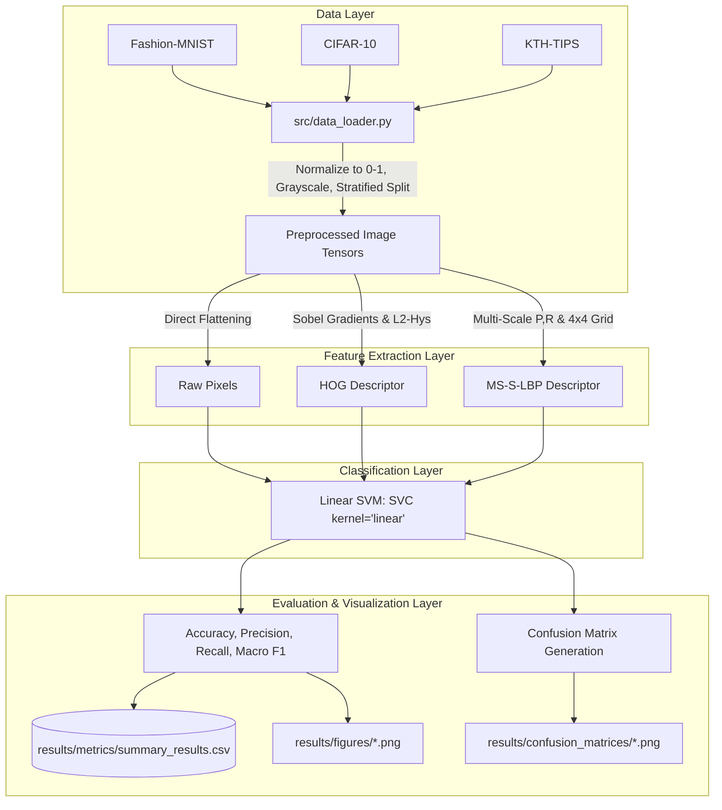

---

## 6. Quantitative Results & Comparative Analysis

### 6.1 Consolidated Benchmark Results

Below are the exact empirical results recorded from the experimental runs (`results/metrics/summary_results.csv`):

| Dataset | Feature Method | Accuracy | Macro Precision | Macro Recall | Macro F1-Score | Feature Dimension |
|:---|:---|:---:|:---:|:---:|:---:|:---:|
| **Fashion-MNIST** | Raw Pixel | 83.05% | 83.59% | 83.24% | 83.35% | 784 |
| **Fashion-MNIST** | **HOG** | **85.80%** | **86.08%** | **85.99%** | **86.00%** | 1,296 |
| **Fashion-MNIST** | LBP (MS-S-LBP) | 85.05% | 85.33% | 85.19% | 85.18% | 864 |
| **CIFAR-10** | Raw Pixel | 23.90% | 23.88% | 23.66% | 23.59% | 1,024 |
| **CIFAR-10** | HOG | 43.75% | 44.28% | 43.57% | 43.69% | 1,764 |
| **CIFAR-10** | **LBP (MS-S-LBP)** | **44.00%** | **43.78%** | **43.68%** | **43.64%** | 864 |
| **KTH-TIPS** | Raw Pixel | 48.15% | 61.46% | 47.68% | 45.66% | 16,384 |
| **KTH-TIPS** | HOG | 64.81% | 70.89% | 64.93% | 65.76% | 34,596 |
| **KTH-TIPS** | **LBP (MS-S-LBP)** | **72.22%** | **77.39%** | **72.35%** | **71.81%** | **864** |

---

### 6.2 Fashion-MNIST Performance & Error Analysis

<div align="center">

| Metric Comparisons | Macro F1 Comparison |
|:---:|:---:|
|  | 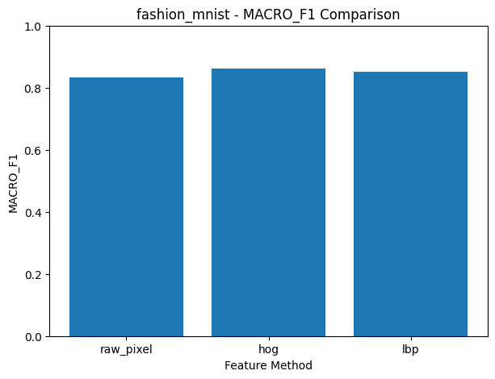 |

</div>

#### Confusion Matrix Analysis:
<div align="center">

| Raw Pixel CM | HOG CM (Winner) | LBP CM |
|:---:|:---:|:---:|
| 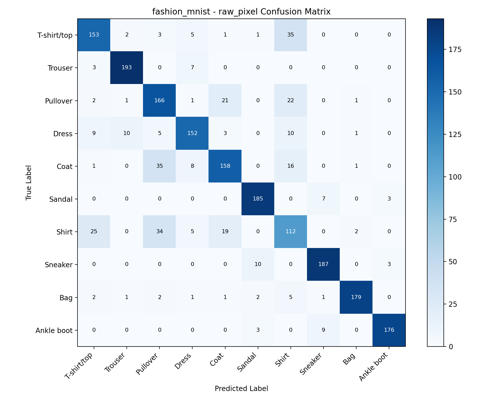 | 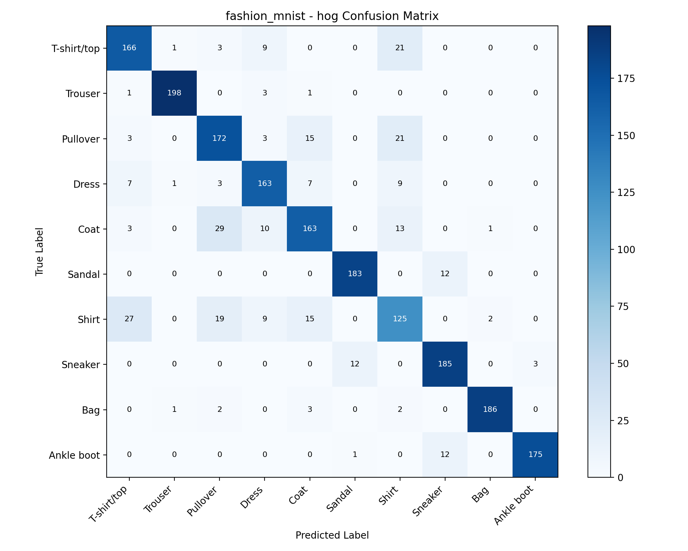 | 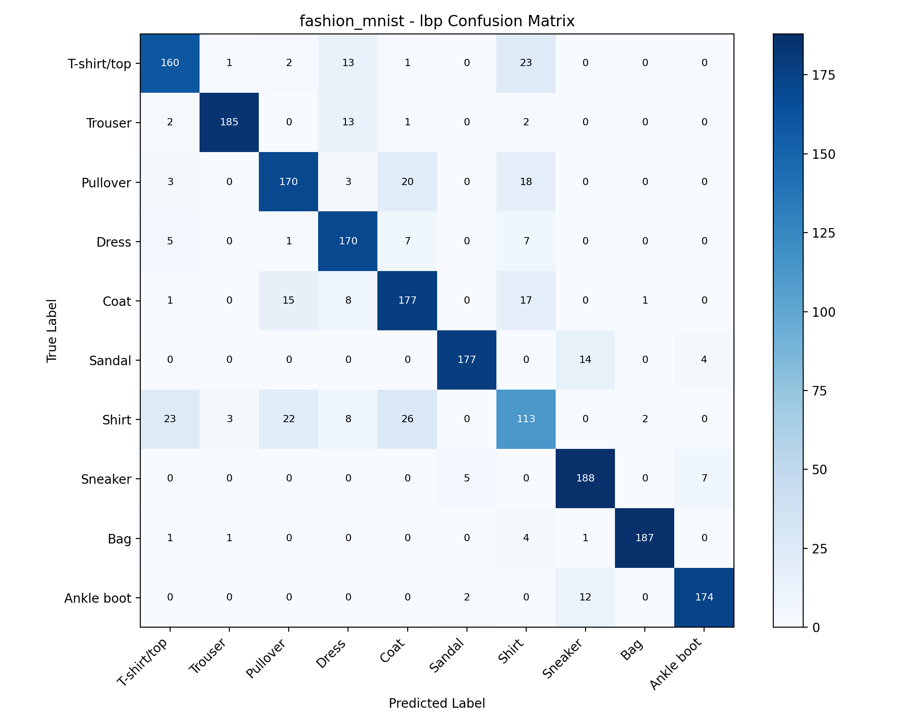 |

</div>

#### Detailed Observations:
1. **HOG Superiority:** HOG attained the highest accuracy (**85.80%**), reinforcing the premise that fashion articles are distinguished by outer silhouettes, collars, hemlines, and structural contours.
2. **Class Confusion:** Across all three descriptors, the most persistent confusion occurred between structurally related apparel:
   - `Shirt` $\leftrightarrow$ `T-shirt/top` $\leftrightarrow$ `Pullover` $\leftrightarrow$ `Coat`.
   - In contrast, footwear (`Sandal`, `Sneaker`, `Ankle boot`) and `Trouser` exhibited near-perfect diagonal concentration in HOG due to highly distinctive aspect ratios and edge gradients.
3. **LBP Resilience:** Even though LBP is primarily a texture descriptor, the $4 \times 4$ spatial grid partitioning preserved sufficient structural topology to reach **85.05%**, falling just $0.75\%$ behind HOG.

---

### 6.3 CIFAR-10 Performance & Error Analysis

<div align="center">

| Metric Comparisons | Macro F1 Comparison |
|:---:|:---:|
| 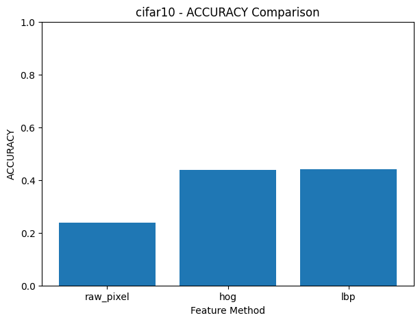 | 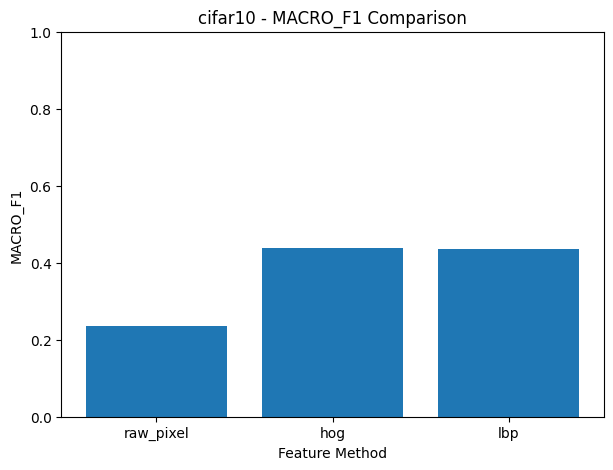 |

</div>

#### Confusion Matrix Analysis:
<div align="center">

| Raw Pixel CM | HOG CM | LBP CM (Winner) |
|:---:|:---:|:---:|
| 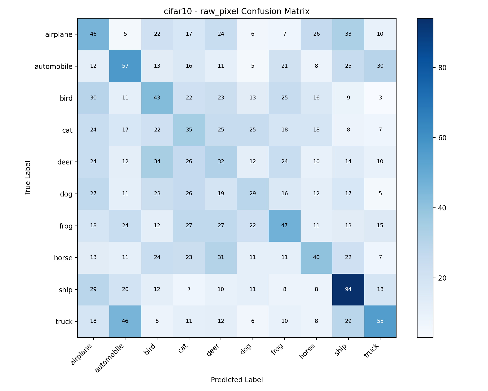 | 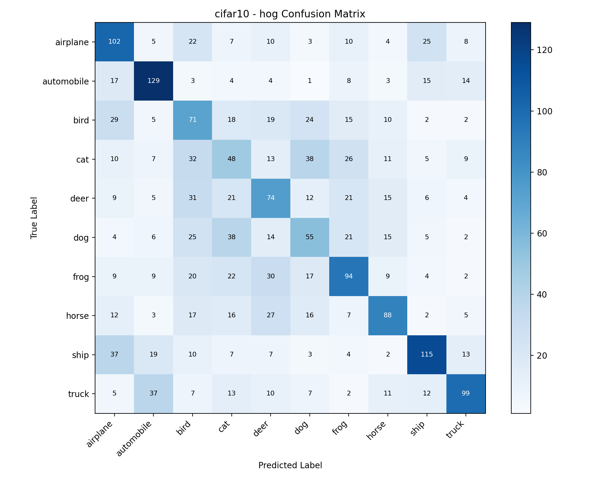 | 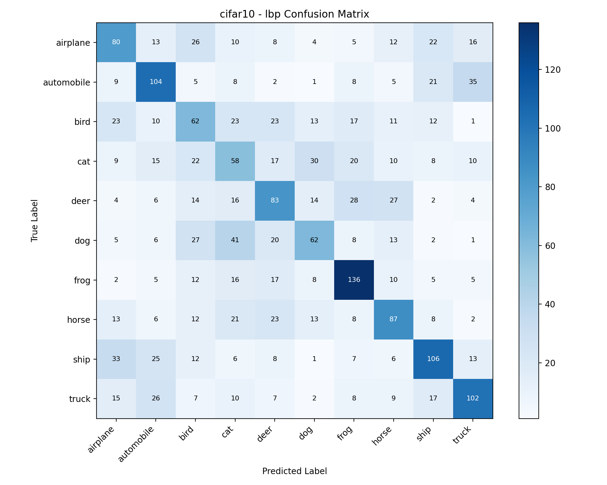 |

</div>

#### Detailed Observations:
1. **Raw Pixel Collapse:** Raw pixel accuracy plunged to **23.90%** (barely above the 10% random chance baseline). Without invariance to background clutter, lighting variations, and spatial shifts, raw pixels are incapable of forming linearly separable clusters on unconstrained natural scenes.
2. **Equivalence of HOG and LBP:** HOG (43.75%) and LBP (44.00%) performed virtually identically. Natural scene recognition demands both edge structures (e.g., wheels, vehicle chassis, wings) and texture patterns (e.g., animal fur, feathers). Neither descriptor alone is sufficient to dominate open-world complexity.
3. **Severe Inter-Class Confusion:**
   - Quadruped animals (`cat` $\leftrightarrow$ `dog` $\leftrightarrow$ `deer` $\leftrightarrow$ `horse`) heavily confused one another.
   - Vehicles (`automobile` $\leftrightarrow$ `truck`, `airplane` $\leftrightarrow$ `ship`) formed distinct sub-clusters but suffered from viewpoint diversity.

---

### 6.4 KTH-TIPS Performance & Error Analysis

<div align="center">

| Metric Comparisons | Macro F1 Comparison |
|:---:|:---:|
| 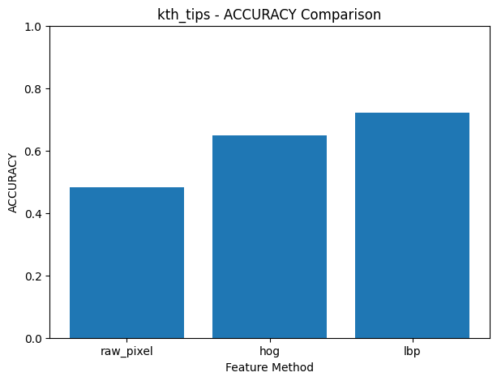 | 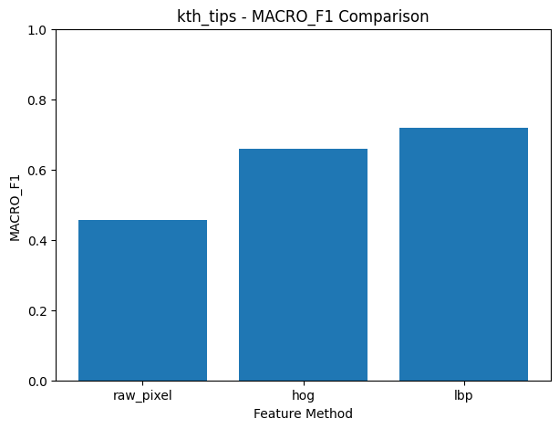 |

</div>

#### Confusion Matrix Analysis:
<div align="center">

| Raw Pixel CM | HOG CM | LBP CM (Decisive Winner) |
|:---:|:---:|:---:|
| 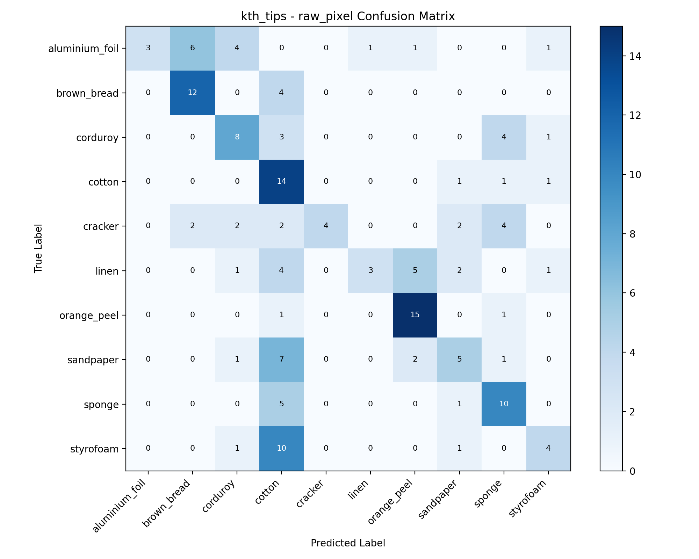 | 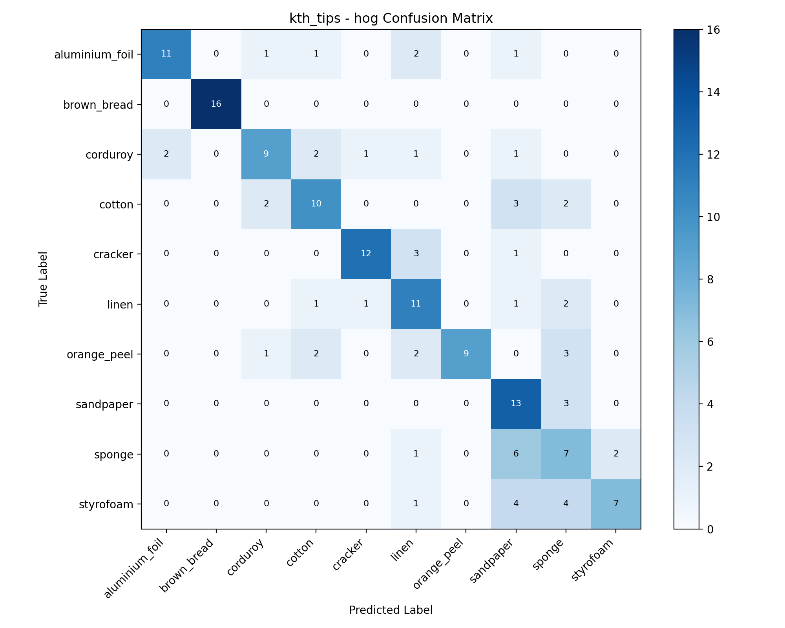 | 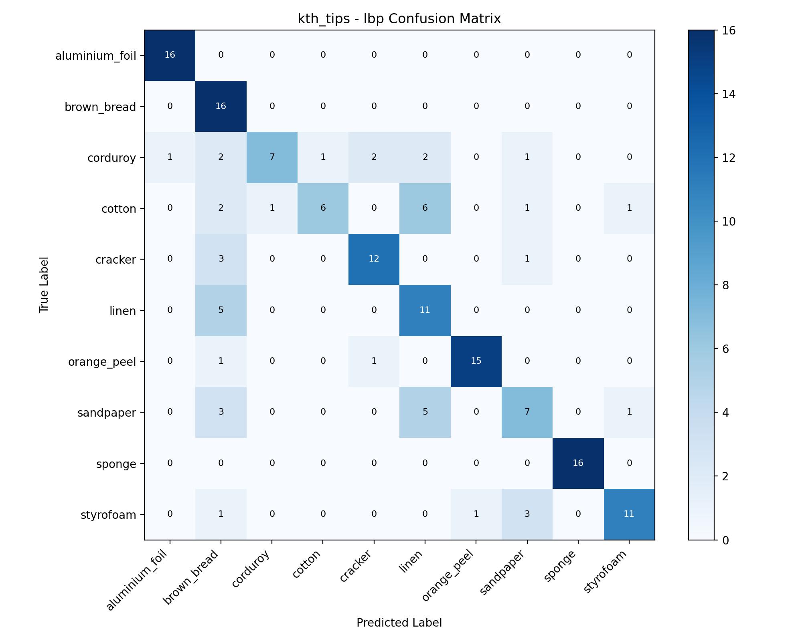 |

</div>

#### Detailed Observations:
1. **LBP Complete Dominance:** Multi-Scale Spatial LBP achieved **72.22% accuracy**, dramatically outperforming HOG (64.81%) by **+7.41%** and Raw Pixels (48.15%) by **+24.07%**.
2. **Texture-Specific Strength:** Material surfaces (such as corduroy, linen, sponge, sandpaper) lack global structural geometry; they are defined strictly by micro-relief and repetitive local intensity relationships. Multi-scale circular sampling ($R \in \{1, 2, 3\}$) perfectly matches this spatial frequency structure.
3. **Clean Diagonal Concentration:** As observed in `kth_tips_lbp_cm.png`, LBP's confusion matrix exhibits crisp diagonal sharpness with minimal off-diagonal leakage, whereas HOG and Raw Pixels suffer substantial confusion across visually rough materials (e.g., styrofoam vs. sponge vs. white bread).

---

## 7. Dimensionality vs. Performance Trade-off

A critical engineering consideration in real-time computer vision is **computational complexity, memory footprint, and the curse of dimensionality**. 

The results on KTH-TIPS present a striking empirical contrast:

| Method | Accuracy | Feature Vector Length | Memory per 1,000 Samples | Accuracy per 1,000 Dimensions |
|:---|:---:|:---:|:---:|:---:|
| **HOG** | 64.81% | **34,596** | ~138.4 MB (float32) | 1.87% |
| **MS-S-LBP** | **72.22%** | **864** | **~3.45 MB** (float32) | **83.58%** |
| *Efficiency Gain* | **+7.41%** | **40x Reduction** | **40x Lower Memory** | **44.7x More Efficient** |

```
Feature Dimension on KTH-TIPS (Logarithmic scale representation):
HOG:       ======================================== (34,596 dims) -> Acc: 64.81%
Raw Pixel: =================== (16,384 dims)                      -> Acc: 48.15%
MS-S-LBP:  = (864 dims)                                           -> Acc: 72.22% (WINNER)
```

> [!TIP]
> **Key Takeaway:** Higher dimensionality does **not** imply superior discriminative power. Generating 34,596 HOG features on $128 \times 128$ texture images led to severe sparsity, slower SVM quadratic programming optimization, and lower accuracy. In contrast, the engineered 864-dimensional MS-S-LBP achieved a **40x more compact representation** while delivering the **highest classification accuracy**.

---

## 8. Hypotheses vs. Empirical Findings

| Dataset | Prior Research Hypothesis | Empirical Finding | Status |
|---|---|---|:---:|
| **Fashion-MNIST** | **HOG** will achieve top performance because apparel classes are characterized by structural silhouettes and edge gradients. | HOG achieved **85.80%**, outperforming Raw Pixels (83.05%) and LBP (85.05%). | **CONFIRMED** |
| **CIFAR-10** | **HOG and LBP** will exhibit comparable performance; raw pixels will collapse due to natural scene complexity. | Raw pixels collapsed to **23.90%**. HOG (**43.75%**) and LBP (**44.00%**) showed near-identical parity ($\Delta = 0.25\%$). | **CONFIRMED** |
| **KTH-TIPS** | **MS-S-LBP** will significantly outperform other methods because the dataset is strictly texture-oriented. | LBP achieved **72.22%**, beating HOG (64.81%) by **+7.41%** and Raw Pixels (48.15%) by **+24.07%**. | **CONFIRMED** |

---

## 9. Conclusions & Future Directions

### 9.1 Academic Conclusions
1. **The "No Free Lunch" Theorem in Feature Descriptors:** No single handcrafted visual representation is universally optimal. Feature extraction algorithms must be selected based on the domain's dominant visual modality (shape-driven vs. texture-driven).
2. **Edge Information for Shape (HOG):** Where silhouettes and clear boundary transitions define class semantics, gradient orientation histograms remain the gold standard handcrafted descriptor.
3. **Multi-Scale Spatial LBP for Surfaces (MS-S-LBP):** Combining multi-scale concentric circular sampling with spatial grid partitioning yields an exceptionally compact (864-D), illumination-invariant, and highly discriminative texture descriptor.
4. **Failure of Raw Pixels:** Directly vectorizing raw pixel intensities without spatial transformation fails completely on unconstrained imagery and severely degrades on textured surfaces.

### 9.2 Future Roadmap (Pattern Recognition Transition)
In this study, HOG demonstrated the most consistent stability across all three datasets (Fashion-MNIST: 85.80%, CIFAR-10: 43.75%, KTH-TIPS: 64.81%), making it an ideal anchor descriptor.
- **Fixed Feature Extraction:** In the subsequent Pattern Recognition phase, the feature extractor will be fixed to HOG (or a hybrid HOG+LBP concatenated representation).
- **Classifier Exploration:** The independent variable will transition from feature extraction to the decision engine:
  - Non-linear Kernel SVM (RBF, Polynomial)
  - Ensemble Classifiers (Random Forest, XGBoost)
  - Multi-Layer Perceptrons (MLP / Shallow Neural Networks)
  - Metric Learning & Dimensionality Reduction (PCA, LDA, t-SNE)

---

## 10. Repository Structure

```
cv-feature-project/
├── .gitignore               # Standard gitignore (ignores pycache, dumps, temp files)
├── README.md                # Primary English academic documentation
├── README_TR.md             # Complete Turkish academic documentation
├── requirements.txt         # Project dependencies
├── config.py                # Global hyperparameters, directory paths, and class labels
├── main.py                  # Entry point to execute the full experimental pipeline
├── src/
│   ├── __init__.py
│   ├── config.py            # (Import alias / configuration bridge)
│   ├── data_loader.py       # Data loading, grayscale conversion, normalization, splitting
│   ├── features.py          # Implementations: Raw Pixels, HOG, Multi-Scale Spatial LBP
│   ├── train_eval.py        # Linear SVM training and multi-metric evaluation
│   ├── visualization.py     # Matplotlib generation: metric bar charts & confusion matrices
│   └── experiments.py       # Full benchmark orchestration loop
├── data/
│   └── raw/
│       └── KTH_TIPS/        # KTH-TIPS texture dataset (810 images across 10 classes)
└── results/
    ├── metrics/
    │   └── summary_results.csv   # Exact quantitative benchmark output metrics
    ├── figures/                  # Bar charts comparing Acc, Precision, Recall, Macro F1
    └── confusion_matrices/       # 9 high-resolution confusion matrix heatmaps
```

---

## 11. Installation & Reproduction Guide

### Prerequisites
- Python 3.10, 3.11, 3.12, or 3.13
- Git

### 1. Clone the Repository
```bash
git clone <repository_url>
cd cv-feature-project
```

### 2. Create and Activate Virtual Environment
```bash
# On Windows (PowerShell):
python -m venv venv
.\venv\Scripts\Activate.ps1

# On Linux / macOS:
python3 -m venv venv
source venv/bin/activate
```

### 3. Install Dependencies
```bash
pip install --upgrade pip
pip install -r requirements.txt
```

### 4. Run the Full Benchmark Suite
Execute the entire pipeline with a single command:
```bash
python main.py
```

This will automatically:
1. Load and normalize **Fashion-MNIST**, **CIFAR-10**, and **KTH-TIPS**.
2. Extract **Raw Pixels**, **HOG**, and **Multi-Scale Spatial LBP** features.
3. Train linear SVM classifiers across all 9 experimental combinations.
4. Evaluate accuracy, precision, recall, and macro F1 scores.
5. Export `results/metrics/summary_results.csv`.
6. Generate 12 comparison bar charts in `results/figures/`.
7. Generate 9 confusion matrix plots in `results/confusion_matrices/`.

---

## 12. Academic Citation & License

### Author Attribution
This project and all associated code, experimental architectures, and evaluations were solely designed and implemented by **Ersin Sandal** for the Undergraduate Computer Vision course curriculum.

### License
This project is licensed under the **MIT License** - see the [LICENSE](LICENSE) file for details.
