<div align="center">

# Bilgisayarlı Görmede Öznitelik Çıkarım Yöntemlerinin Nicel Karşılaştırmalı Analizi
### Akademik Araştırma ve Karşılaştırmalı Değerlendirme: Ham Pikseller (Raw Pixels) vs. HOG vs. Çok Ölçekli Mekansal LBP (MS-S-LBP)

[](https://www.python.org/)
[](https://scikit-learn.org/)
[](https://opencv.org/)
[](https://www.tensorflow.org/)
[](LICENSE)

<br/>

[](README.md)

<p align="center">
  <b>Yazar:</b> Ersin Sandal &nbsp;|&nbsp; <b>Bilgisayar Mühendisi</b>
</p>

---

</div>

> [!NOTE]
> **Dil Seçimi / Language Toggle:**  
> İngilizce ana dokümantasyona ulaşmak için yukarıdaki mavi butona veya [buraya (README.md)](README.md) tıklayabilirsiniz.

---

## 📑 İçindekiler

- [1. Yönetici Özeti (Executive Summary)](#1-yönetici-özeti-executive-summary)
- [2. Araştırma Problemi ve Teorik Motivasyon](#2-araştırma-problemi-ve-teorik-motivasyon)
  - [2.1 Temel Bilimsel Soru](#21-temel-bilimsel-soru)
  - [2.2 Metodolojik Titizlik: Kontrollü Deney Düzeneği](#22-metodolojik-titizlik-kontrollü-deney-düzeneği)
  - [2.3 Neden Evrişimli Sinir Ağları (CNN) Kullanılmadı?](#23-neden-evrişimli-sinir-ağları-cnn-kullanılmadı)
- [3. Öznitelik Çıkarım Yöntemleri ve Algoritmik Detaylar](#3-öznitelik-çıkarım-yöntemleri-ve-algoritmik-detaylar)
  - [3.1 Referans Noktası: Normalize Ham Piksel Temsili (Raw Pixels)](#31-referans-noktası-normalize-ham-piksel-temsili-raw-pixels)
  - [3.2 Yönlendirilmiş Gradyanlar Histogramı (HOG)](#32-yönlendirilmiş-gradyanlar-histogramı-hog)
  - [3.3 Çok Ölçekli Mekansal Yerel İkili Örüntüler (Multi-Scale Spatial LBP)](#33-çok-ölçekli-mekansal-yerel-ikili-örüntüler-multi-scale-spatial-lbp)
- [4. Kıyaslama Veri Kümeleri (Benchmark Datasets)](#4-kıyaslama-veri-kümeleri-benchmark-datasets)
  - [4.1 Fashion-MNIST (Şekil / Kontur Odaklı)](#41-fashion-mnist-şekil--kontur-odaklı)
  - [4.2 CIFAR-10 (Karmaşık Doğal Nesneler)](#42-cifar-10-karmaşık-doğal-nesneler)
  - [4.3 KTH-TIPS (Doku / Yüzey Odaklı)](#43-kth-tips-doku--yüzey-odaklı)
- [5. Sistem Mimarisi ve Deney Hattı (Pipeline)](#5-sistem-mimarisi-ve-deney-hattı-pipeline)
- [6. Sayısal Sonuçlar ve Karşılaştırmalı Analiz](#6-sayısal-sonuçlar-ve-karşılaştırmalı-analiz)
  - [6.1 Konsolide Test Sonuçları Tablosu](#61-konsolide-test-sonuçları-tablosu)
  - [6.2 Fashion-MNIST Performansı ve Hata Analizi](#62-fashion-mnist-performansı-ve-hata-analizi)
  - [6.3 CIFAR-10 Performansı ve Hata Analizi](#63-cifar-10-performansı-ve-hata-analizi)
  - [6.4 KTH-TIPS Performansı ve Hata Analizi](#64-kth-tips-performansı-ve-hata-analizi)
- [7. Boyutsallık vs. Performans Dengesi (Verimlilik Analizi)](#7-boyutsallık-vs-performans-dengesi-verimlilik-analizi)
- [8. Hipotezler ve Ampirik Bulgular](#8-hipotezler-ve-ampirik-bulgular)
- [9. Çıkarımlar ve Gelecek Çalışmalar](#9-çıkartımlar-ve-gelecek-çalışmalar)
- [10. Proje Dizin Yapısı](#10-proje-dizin-yapısı)
- [11. Kurulum ve Yeniden Üretilebilirlik Kılavuzu](#11-kurulum-ve-yeniden-üretilebilirlik-kılavuzu)
- [12. Akademik Atıf ve Lisans](#12-akademik-atıf-ve-lisans)

---

## 1. Yönetici Özeti (Executive Summary)

Bilgisayarlı görmede (Computer Vision), yüksek boyutlu görsel verinin makine öğrenmesi algoritmaları tarafından işlenebilir, ayrıştırıcı ve sağlam sayısal vektörlere dönüştürülmesi (**öznitelik çıkarımı / feature extraction**), nihai sınıflandırma başarısını belirleyen en kritik adımdır. Bu çalışma, üç temel öznitelik temsil yönteminin **kapsamlı ve nicel (quantitative) karşılaştırmalı analizini** sunmaktadır:

1. **Normalize Ham Pikseller (Raw Pixels)**: Hiçbir uzamsal dönüşüm uygulanmayan referans temel hat (baseline).
2. **Yönlendirilmiş Gradyanlar Histogramı (HOG)**: Kenar doğrultuları, kontur ve geometrik şekil dağılımlarını yakalayan operatör.
3. **Çok Ölçekli Mekansal Yerel İkili Örüntüler (Multi-Scale Spatial LBP)**: Mikro düzeydeki yüzey dokularını ve komşuluk ilişkilerini hiyerarşik olarak kodlayan operatör.

Öznitelik yöntemlerinin temsil gücünü sınıflandırıcı kaynaklı değişkenlerden tamamen izole etmek adına, tüm deneylerde sınıflandırıcı mekanizması **Lineer Destek Vektör Makineleri (Linear SVM)** olarak sabit tutulmuştur. Değerlendirme, birbirinden tamamen farklı görsel morfolojilere sahip üç saygın veri kümesi üzerinde gerçekleştirilmiştir:
- **Fashion-MNIST** (Belirgin silüet ve şekil odaklı giyim ürünleri)
- **CIFAR-10** (Karmaşık arka plan ve yüksek sınıf içi varyasyona sahip doğal nesneler)
- **KTH-TIPS** (Farklı aydınlatma, açı ve ölçek altındaki saf malzeme dokuları)

### Temel Ampirik Bulgular:
- **Evrensel Olarak "En İyi" Tek Bir Yöntem Yoktur:** Her veri kümesinde üstün gelen tek bir öznitelik çıkarıcı bulunmamaktadır ("No Free Lunch"). Başarı, veri kümesinin baskın görsel karakteristiği (şekil vs. doku) ile doğrudan bağıntılıdır.
- **Şekil Baskınlığı:** Fashion-MNIST üzerinde **HOG %85.80 doğrulukla en yüksek performansı elde etmiştir**. Bu sonuç, kenar yönelim dağılımlarının nesne silüetlerini ayrıştırmadaki gücünü kanıtlamaktadır.
- **Doku Üstünlüğü ve Boyutsal Verimlilik:** KTH-TIPS üzerinde **Çok Ölçekli Mekansal LBP %72.22 doğruluk** elde ederek HOG'u (%64.81) ve Ham Pikselleri (%48.15) geride bırakmıştır. En çarpıcı bulgu ise LBP'nin bu başarıya yalnızca **864 boyutlu** kompakt bir vektörle ulaşması, HOG'un ise **34.596 boyutlu** devasa bir vektöre rağmen daha düşük başarı göstermesidir (**40 kat boyut tasarrufu ile +%7.41 doğruluk artışı**).
- **Doğal Görüntü Karmaşıklığı:** CIFAR-10 üzerinde HOG (%43.75) ve LBP (%44.00) neredeyse başa baş sonuçlar verirken, Ham Piksel yaklaşımı %23.90 seviyesine çökmüştür. Bu durum, açık dünya sahnelerinde doğrusal ayrılabilirlik için hem kenar hem de doku ipuçlarının birlikte gerekli olduğunu ortaya koymaktadır.

---

## 2. Araştırma Problemi ve Teorik Motivasyon

### 2.1 Temel Bilimsel Soru

Görsel örüntü tanıma süreçlerinde temel akış şu şekildedir:

$$
\mathbf{x} \in \mathbb{R}^{H \times W \times C} \xrightarrow{\quad \Phi(\cdot) \quad} \mathbf{z} \in \mathbb{R}^{D} \xrightarrow{\quad f_{\mathbf{w}}(\cdot) \quad} \hat{y} \in \{1, \dots, K\}
$$

Burada $\Phi(\cdot)$ öznitelik çıkarım dönüşümünü, $f_{\mathbf{w}}(\cdot)$ ise karar fonksiyonunu temsil eder.

Modern derin öğrenme modelleri $\Phi(\cdot)$ fonksiyonunu uçtan uca öğrenirken, klasik bilgisayarlı görme matematiksel ve fiziksel değişmezliklere (invariance) dayanan mühendislik ürünü operatörler kullanır. Bu durum şu temel araştırma sorularını doğurur:
1. *Veri türünden bağımsız, evrensel olarak en iyi çalışan bir klasik öznitelik çıkarım yöntemi var mıdır?*
2. *Yapısal gradyan temsilleri (HOG) ile mikro doku frekans dağılımları (LBP), taban tabana zıt görsel morfolojilerde nasıl bir davranış sergiler?*
3. *Ham pikselleri hiçbir dönüşüme uğratmadan sınıflandırmanın nicel bedeli nedir?*

### 2.2 Metodolojik Titizlik: Kontrollü Deney Düzeneği

Bilimsel geçerliliği garanti altına almak adına çalışma, **kontrollü değişken modeli** prensipleriyle yürütülmüştür:

| Değişken Türü | Varlık | Kontrol / Sabitleme Mekanizması |
|---|---|---|
| **Bağımsız Değişken** | Öznitelik Çıkarım Yöntemi $\Phi(\mathbf{x})$ | Değiştirilen: Ham Piksel, HOG, MS-S-LBP |
| **Kontrol Edilen Değişken** | Sınıflandırıcı Mimarisi $f(\mathbf{z})$ | Sabit Tutulan: Lineer SVM (`SVC(kernel='linear')`) |
| **Kontrol Edilen Değişken** | Veri Bölümleme & Tohum Değeri | Sabit: `random_state=42`, tabakalı (stratified) bölme |
| **Bağımlı Değişkenler** | Sayısal Başarım Metrikleri | Doğruluk, Makro Kesinlik, Makro Duyarlılık, Makro F1, Hata Matrisi |

#### Neden Sınıflandırıcı Olarak Lineer SVM Sabitlendi?

Lineer SVM, öznitelik uzayında kesin doğru/düzlemlerle (hiperdüzlem) sınıf ayrımı yapar:

$$
\min_{\mathbf{w}, b, \boldsymbol{\xi}} \frac{1}{2} \|\mathbf{w}\|^2 + C \sum_{i=1}^{N} \xi_i \quad \text{s.t.} \quad y_i (\mathbf{w}^\top \mathbf{z}_i + b) \ge 1 - \xi_i, \quad \xi_i \ge 0
$$

Karar yüzeyi tamamen lineer olduğu için, sınıflandırıcının karmaşık non-lineer ilişkileri "uydurma" (overfit) veya öznitelik zayıflıklarını maskeleme kabiliyeti yoktur. Dolayısıyla elde edilen yüksek başarım, öznitelik çıkarıcının ($\Phi$) ham pikselleri **doğrusal olarak ayrılabilir bir uzaya başarıyla izdüşürdüğünün doğrudan kanıtıdır**. Bu sayede performans farkı yalnızca ve yalnızca öznitelik yöntemine atfedilebilir.

### 2.3 Neden Evrişimli Sinir Ağları (CNN) Kullanılmadı?

Evrişimli Sinir Ağları (CNN), öznitelik çıkarımı ile sınıflandırma katmanlarını uçtan uca (end-to-end) birleşik bir optimizasyonla öğrenir:

$$
\mathcal{L}_{\text{CNN}} = \mathcal{L}\left( f\left(\Phi(\mathbf{x})\right), y \right)
$$

Bu yaklaşımda:
- Öznitelik çıkarımı ($\Phi$), sınıflandırma katmanı ($f$), öğrenme oranı, optimizasyon algoritması ve veri artırma (augmentation) parametreleriyle iç içe geçer.
- Başarının evrişim filtrelerinin matematiksel yapısından mı, ağın derinliğinden mi yoksa parametre sayısından mı kaynaklandığını izole etmek imkansızdır.
- Klasik operatörler ve sabit lineer sınıflandırıcı, öznitelik kalitesini hiçbir harici faktörün gölgesinde bırakmadan saf biçimde ölçmeyi mümkün kılar.

---

## 3. Öznitelik Çıkarım Yöntemleri ve Algoritmik Detaylar

```
+-----------------------------------------------------------------------------+
|                             GİRİŞ GÖRÜNTÜSÜ (x)                             |
+-----------------------------------------------------------------------------+
         |                                |                               |
         v                                v                               v
+------------------+            +-------------------+           +-------------------+
| 1. HAM PİKSEL    |            | 2. HOG DÖNÜŞÜMÜ   |           | 3. MS-S-LBP       |
| Düzleştirilmiş   |            | Kenar Gradyanları |           | Çok Ölçekli Izgara|
| Dönüşümsüz Vektör|            | 9 Bin, 4x4 Hücre  |           | P={8,16,24}, 4x4  |
+------------------+            +-------------------+           +-------------------+
         |                                |                               |
         | D=784 / 1024 / 16384           | D=1296 / 1764 / 34596         | D=864 (Sabit)     |
         +--------------------------------+-------------------------------+
                                          |
                                          v
                         +---------------------------------+
                         |      LİNEER SVM SINIFLANDIRICI  |
                         |   SVC(kernel="linear", C=1.0)   |
                         +---------------------------------+
                                          |
                                          v
                         +---------------------------------+
                         |      PERFORMANS DEĞERLENDİRME   |
                         | Acc, Macro-F1, Karmaşıklık Matrisi
                         +---------------------------------+
```

### 3.1 Referans Noktası: Normalize Ham Piksel Temsili (Raw Pixels)

Görüntü üzerindeki piksel yoğunluk değerlerinin hiçbir filtreye tabi tutulmadan düzleştirilip $[0.0, 1.0]$ aralığına normalize edilmesiyle elde edilir:

$$
\mathbf{z}_{\text{raw}} = \text{vec}\left(\frac{\mathbf{I}}{255.0}\right) \in [0.0, 1.0]^D
$$

- **Kod Karşılığı:** `src/features.py -> extract_raw_pixels(images)`
- **Oluşan Boyutlar:**
  - Fashion-MNIST ($28 \times 28$): $D = 784$
  - CIFAR-10 ($32 \times 32$ gri ton): $D = 1.024$
  - KTH-TIPS ($128 \times 128$): $D = 16.384$
- **Teorik Sınırları:** Görüntünün uzamsal öteleme (translation), dönme (rotation), ölçek ve ışık değişimlerine karşı hiçbir toleransı yoktur. Piksellerin birebir aynı konumlarda çakışmasını bekler.

---

### 3.2 Yönlendirilmiş Gradyanlar Histogramı (HOG)

Dalal & Triggs (2005) tarafından geliştirilen HOG yöntemi, nesne kenarlarının ve konturlarının gradyan yönelim dağılımları üzerinden güçlü bir yapısal temsil üretir.

1. **Gradyan Hesabı:**
   Görüntünün yatay ve dikey türevleri 1B türev maskeleriyle alınır:

   $$I_x = I * [-1, 0, 1], \quad I_y = I * [-1, 0, 1]^\top$$

   Gradyan büyüklüğü $M(x, y)$ ve yönsüz açı değeri $\theta(x, y)$ hesaplanır:

   $$M(x, y) = \sqrt{I_x(x,y)^2 + I_y(x,y)^2}, \quad \theta(x, y) = \arctan\left(\frac{I_y(x,y)}{I_x(x,y)}\right) \pmod{180^\circ}$$

2. **Hücre ve Yön Kümeleri (Binning):**
   Görüntü `pixels_per_cell=(4, 4)` boyutlarında küçük hücrelere ayrılır. Her hücredeki gradyan açıları $[0^\circ, 180^\circ)$ aralığını temsil eden **9 adet açı kutucuğuna (bin)** büyüklükleri oranında eklenir.

3. **Blok Kontrast Normalizasyonu:**
   Aydınlatma ve gölge etkilerini gidermek için hücreler `cells_per_block=(2, 2)` boyutunda çakışan bloklarda birleştirilir ve **L2-Hys** yöntemiyle normalleştirilir:

   $$\mathbf{v}_{\text{norm}} = \frac{\mathbf{v}}{\sqrt{\|\mathbf{v}\|_2^2 + \epsilon^2}}$$

- **Kod Karşılığı:** `skimage.feature.hog` aracılığıyla `src/features.py -> extract_hog_features(images)`
- **Vektör Boyutu Hesabı:**
  - Fashion-MNIST ($28 \times 28$): $7 \times 7$ hücre $\to 6 \times 6 = 36$ blok $\to 36 \times 4 \times 9 = \mathbf{1.296}$ boyut
  - CIFAR-10 ($32 \times 32$): $8 \times 8$ hücre $\to 7 \times 7 = 49$ blok $\to 49 \times 4 \times 9 = \mathbf{1.764}$ boyut
  - KTH-TIPS ($128 \times 128$): $32 \times 32$ hücre $\to 31 \times 31 = 961$ blok $\to 961 \times 4 \times 9 = \mathbf{34.596}$ boyut

---

### 3.3 Çok Ölçekli Mekansal Yerel İkili Örüntüler (Multi-Scale Spatial LBP)

Standart LBP (Ojala vd.), merkez piksel ile yarıçap $R$ üzerindeki $P$ adet dairesel komşu arasındaki parlaklık farklarını ikili (binary) bir koda dönüştürür:

$$
\text{LBP}_{P, R}(x_c, y_c) = \sum_{p=0}^{P-1} s(g_p - g_c) 2^p, \quad s(z) = \begin{cases} 1, & z \ge 0 \\ 0, & z < 0 \end{cases}
$$

Standart LBP'nin tek ölçeğe bağımlı kalmasını engellemek ve global uzamsal yerleşimi kaybetmemek adına bu projede özgün bir **Çok Ölçekli Mekansal LBP (Multi-Scale Spatial LBP)** mimarisi kurgulanmıştır:

```
+----------------------------------------------------------------------------------+
|               ÇOK ÖLÇEKLİ MEKANSAL LBP (MS-S-LBP) ÇALIŞMA PRENSİBİ               |
+----------------------------------------------------------------------------------+
|                                                                                  |
|   1. ÇOK ÖLÇEKLİ ÇIKARIM                      2. UZAMSAL IZGARA BÖLÜMLEME         |
|   Ölçek 1: P=8,  R=1  --> 10 uniform bin         Görüntü 4x4 Izgaraya Bölünür   |
|   Ölçek 2: P=16, R=2  --> 18 uniform bin              [  0  ][  1  ][  2  ][  3  ]|
|   Ölçek 3: P=24, R=3  --> 26 uniform bin              [  4  ][  5  ][  6  ][  7  ]|
|   Hücre Başına Toplam = 54 bin histogram              [  8  ][  9  ][ 10  ][ 11  ]|
|                                                       [ 12  ][ 13  ][ 14  ][ 15  ]|
|                                                                                  |
|   3. NİHAİ VEKTÖR BİRLEŞTİRME                                                    |
|   Toplam Boyut: 16 hücre x 54 bin = 864 öznitelik (Kompakt ve Ayrıştırıcı)       |
+----------------------------------------------------------------------------------+
```

1. **Çok Ölçekli Eşmerkezli Daireler:**
   Farklı uzamsal frekanslardaki doku desenlerini yakalamak için üç ayrı ölçek eşzamanlı işletilir:
   - Ölçek 1: $P=8, R=1$ (1 piksel yarıçap, 8 komşu)
   - Ölçek 2: $P=16, R=2$ (2 piksel yarıçap, 16 komşu)
   - Ölçek 3: $P=24, R=3$ (3 piksel yarıçap, 24 komşu)

2. **Tekdüze (Uniform) Örüntü Dönüşümü:**
   Gürültüye dayanıklılık sağlayan `method="uniform"` kullanılmıştır. En fazla iki bitlik $0 \to 1$ veya $1 \to 0$ geçişi içeren örüntüler korunarak $P+2$ adet kutucuk (bin) üretilir:
   - Ölçek 1 ($P=8$): 10 bin
   - Ölçek 2 ($P=16$): 18 bin
   - Ölçek 3 ($P=24$): 26 bin
   - Bir hücredeki toplam histogram uzunluğu: $10 + 18 + 26 = 54$ bin.

3. **Uzamsal Izgara Bölümleme ($4 \times 4$ Hücre):**
   Tüm görüntü üzerinden tek bir global histogram almak nesnelerin uzamsal konum bilgisini yok eder. Bu nedenle görüntü **$4 \times 4$ boyutunda 16 eşit alt bölgeye** ayrılır ve her bölgenin normalize histogramları sırayla uç uca eklenir.

4. **Nihai Vektör Uzunluğu:**

   $$D_{\text{LBP}} = 16 \times (10 + 18 + 26) = 16 \times 54 = \mathbf{864}$$

   Görüntü çözünürlüğü ne olursa olsun, **sabit, kompakt ve 864 boyutlu** (16 alt bölge $\times$ 54 bin) yüksek ayrıştırıcılıkta bir öznitelik vektörü üretilir.

- **Kod Karşılığı:** `skimage.feature.local_binary_pattern` aracılığıyla `src/features.py -> extract_lbp_features(images)`

---

## 4. Kıyaslama Veri Kümeleri (Benchmark Datasets)

Farklı görsel nitelikleri temsil eden 3 saygın veri kümesi kullanılmıştır:

| Veri Kümesi | Görsel Nitelik | Çözünürlük | Sınıf | Eğitim Seti | Test Seti | Temel Ayrıştırıcı Unsur |
|---|---|---|---|---|---|---|
| **Fashion-MNIST** | Giyim Ürünleri | $28 \times 28$ Gri Ton | 10 | 10.000 | 2.000 | **Dış silüet, kenar hatları ve kesimler** |
| **CIFAR-10** | Doğal Nesneler | $32 \times 32$ Gri Ton | 10 | 10.000 | 2.000 | **Bileşik yapı (kenar + doku + karmaşık arka plan)** |
| **KTH-TIPS** | Malzeme Dokuları | $128 \times 128$ Gri Ton | 10 | 648 (%80) | 162 (%20) | **Yüzey mikro dokusu ve tekrarlayan pürüzler** |

### 4.1 Fashion-MNIST (Şekil / Kontur Odaklı)
- Zalando Research tarafından MNIST'e modern bir alternatif olarak geliştirilmiştir.
- 10 sınıf içerir: *Tişört, Pantolon, Kazak, Elbise, Palto, Sandalet, Gömlek, Spor Ayakkabı, Çanta, Yarım Bot*.
- Siyah arka plan üzerinde gri nesnelerden oluşur; sınıflar arasındaki temel fark silüet ve dış kontur geometrisidir.

### 4.2 CIFAR-10 (Karmaşık Doğal Nesneler)
- Alex Krizhevsky, Vinod Nair ve Geoffrey Hinton tarafından derlenmiştir.
- 10 sınıf içerir: *uçak, otomobil, kuş, kedi, geyik, köpek, kurbağa, at, gemi, kamyon*.
- ITU-R 601-2 parlaklık ağırlıklarıyla gri tona dönüştürülmüştür:

  $$Y = 0.299 \cdot R + 0.587 \cdot G + 0.114 \cdot B$$

- Kamera açısı çeşitliliği, arka plan karmaşası ve yüksek sınıf içi varyasyon barındırır.

### 4.3 KTH-TIPS (Doku / Yüzey Odaklı)
- KTH Royal Institute of Technology (İsveç) bünyesinde toplanmıştır.
- 10 malzeme sınıfı içerir: *zımpara kağıdı, alüminyum folyo, strafor, sünger, fitilli kadife, keten, pamuk, esmer ekmek, beyaz ekmek, portakal kabuğu*.
- Nesnelerin belirli bir dış silüeti yoktur; ayrıştırma tamamen yüzey mikro dokusu, gözenekler ve pürüz frekansına dayanır.

---

## 5. Sistem Mimarisi ve Deney Hattı (Pipeline)

Sistem tamamen modüler ve otomatikleştirilmiş bir mimariyle tasarlanmıştır:

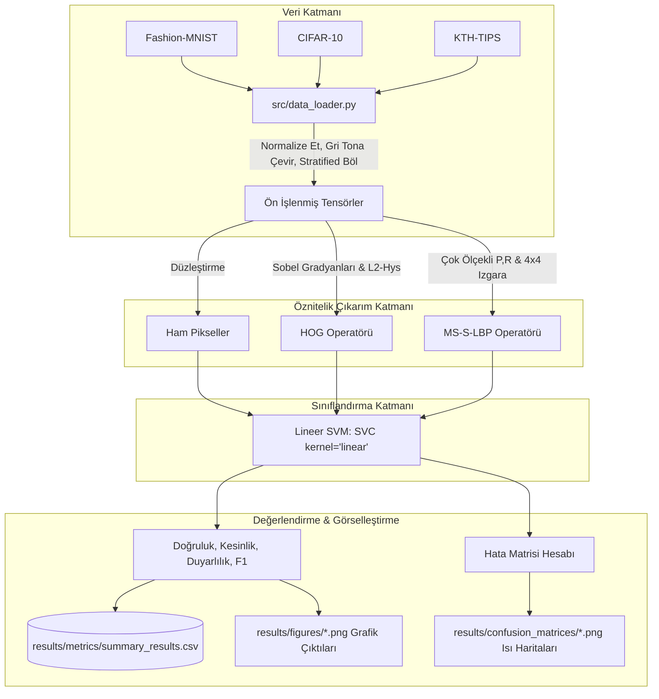

---

## 6. Sayısal Sonuçlar ve Karşılaştırmalı Analiz

### 6.1 Konsolide Test Sonuçları Tablosu

Aşağıdaki veriler, proje deneylerinin doğrudan çalıştırılmasıyla üretilen resmi sonuçlardır (`results/metrics/summary_results.csv`):

| Veri Kümesi | Öznitelik Yöntemi | Doğruluk (Accuracy) | Makro Kesinlik | Makro Duyarlılık | Makro F1 Skoru | Öznitelik Boyutu |
|:---|:---|:---:|:---:|:---:|:---:|:---:|
| **Fashion-MNIST** | Ham Piksel | %83.05 | %83.59 | %83.24 | %83.35 | 784 |
| **Fashion-MNIST** | **HOG** | **%85.80** | **%86.08** | **%85.99** | **%86.00** | 1.296 |
| **Fashion-MNIST** | LBP (MS-S-LBP) | %85.05 | %85.33 | %85.19 | %85.18 | 864 |
| **CIFAR-10** | Ham Piksel | %23.90 | %23.88 | %23.66 | %23.59 | 1.024 |
| **CIFAR-10** | HOG | %43.75 | %44.28 | %43.57 | %43.69 | 1.764 |
| **CIFAR-10** | **LBP (MS-S-LBP)** | **%44.00** | **%43.78** | **%43.68** | **%43.64** | 864 |
| **KTH-TIPS** | Ham Piksel | %48.15 | %61.46 | %47.68 | %45.66 | 16.384 |
| **KTH-TIPS** | HOG | %64.81 | %70.89 | %64.93 | %65.76 | 34.596 |
| **KTH-TIPS** | **LBP (MS-S-LBP)** | **%72.22** | **%77.39** | **%72.35** | **%71.81** | **864** |

---

### 6.2 Fashion-MNIST Performansı ve Hata Analizi

<div align="center">

| Doğruluk Karşılaştırması | Makro F1 Karşılaştırması |
|:---:|:---:|
|  | 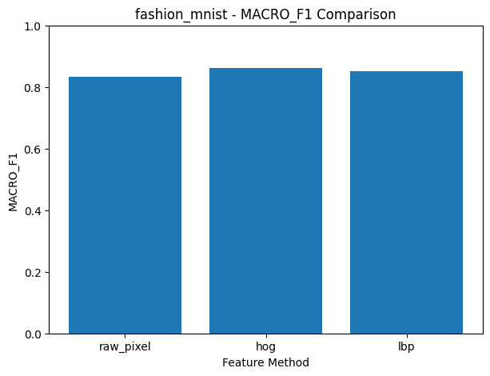 |

</div>

#### Hata Matrisi (Confusion Matrix) İncelemesi:
<div align="center">

| Ham Piksel | HOG (Kazanan Yöntem) | LBP |
|:---:|:---:|:---:|
| 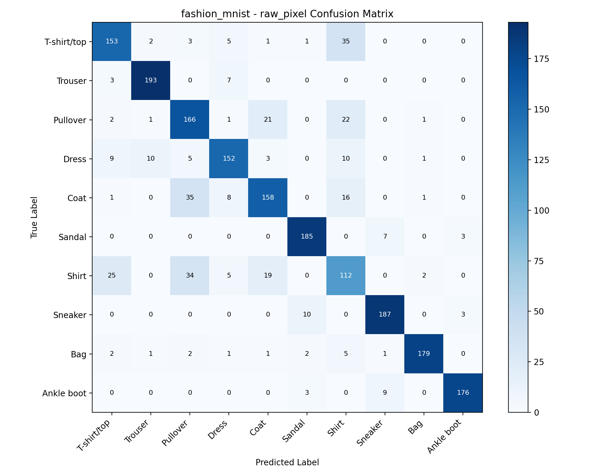 | 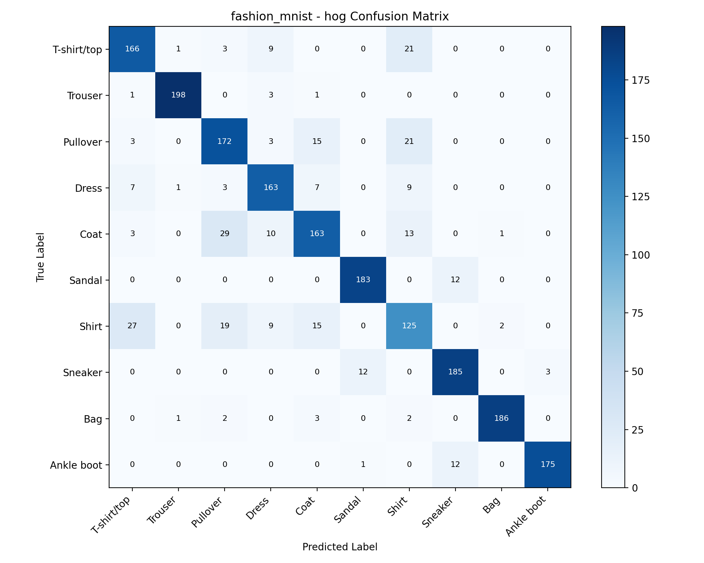 | 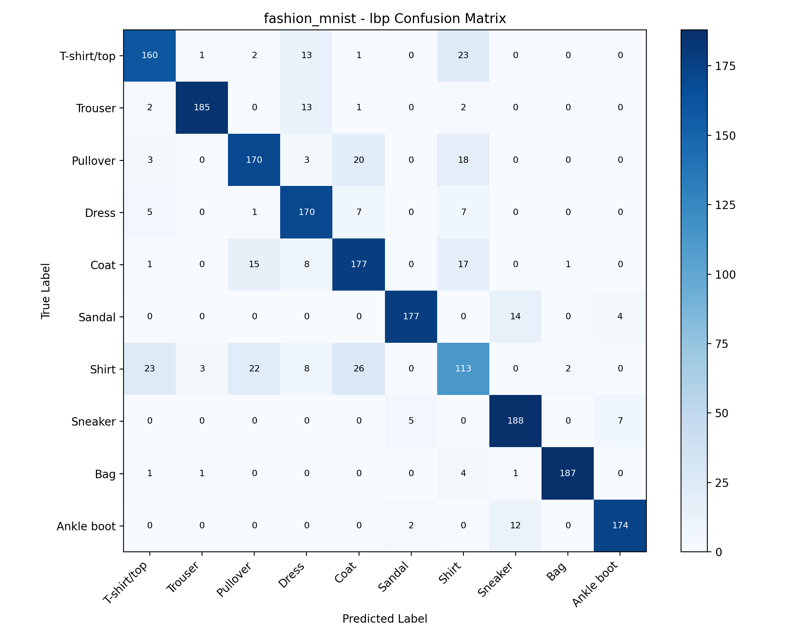 |

</div>

#### Detaylı Gözlemler:
1. **HOG Başarısı:** HOG, **%85.80 doğrulukla** en yüksek başarıyı elde etmiştir. Giyim eşyalarının ayrıştırılmasında silüet, omuz/yaka kesimi ve kenar eğimlerinin birincil belirteç olduğu hipotezi ampirik olarak doğrulanmıştır.
2. **Sınıf Karışıklıkları:** Üç yöntemde de en belirgin karışıklık birbirine yapısal olarak benzeyen üst giyim ürünlerinde gerçekleşmiştir:
   - `Gömlek (Shirt)` $\leftrightarrow$ `Tişört (T-shirt/top)` $\leftrightarrow$ `Kazak (Pullover)` $\leftrightarrow$ `Palto (Coat)`.
   - Buna karşılık alt giyim (`Pantolon`) ve ayakkabı grupları (`Sandalet`, `Sneaker`, `Bot`), kendilerine has en-boy oranları ve kenar doğrultuları sayesinde HOG matrisinde kusursuza yakın bir köşegen netliği sergilemiştir.
3. **LBP'nin Direnci:** LBP özünde bir doku çıkarıcısı olmasına rağmen, uygulanan $4 \times 4$ uzamsal ızgara mekanizması sayesinde makro şekil bilgisini korumuş ve **%85.05** doğrulukla HOG'un yalnızca %0.75 gerisinde kalmıştır.

---

### 6.3 CIFAR-10 Performansı ve Hata Analizi

<div align="center">

| Doğruluk Karşılaştırması | Makro F1 Karşılaştırması |
|:---:|:---:|
| 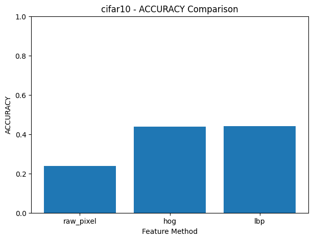 | 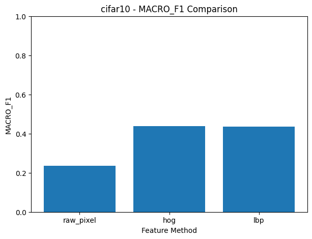 |

</div>

#### Hata Matrisi İncelemesi:
<div align="center">

| Ham Piksel | HOG | LBP (Kazanan Yöntem) |
|:---:|:---:|:---:|
| 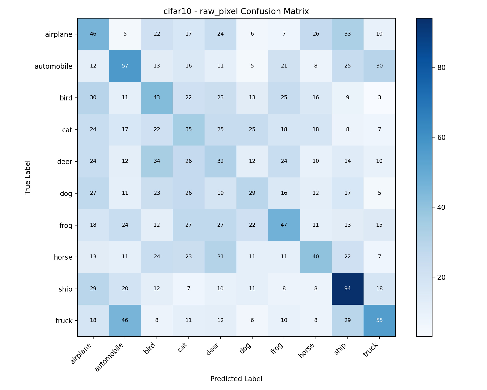 | 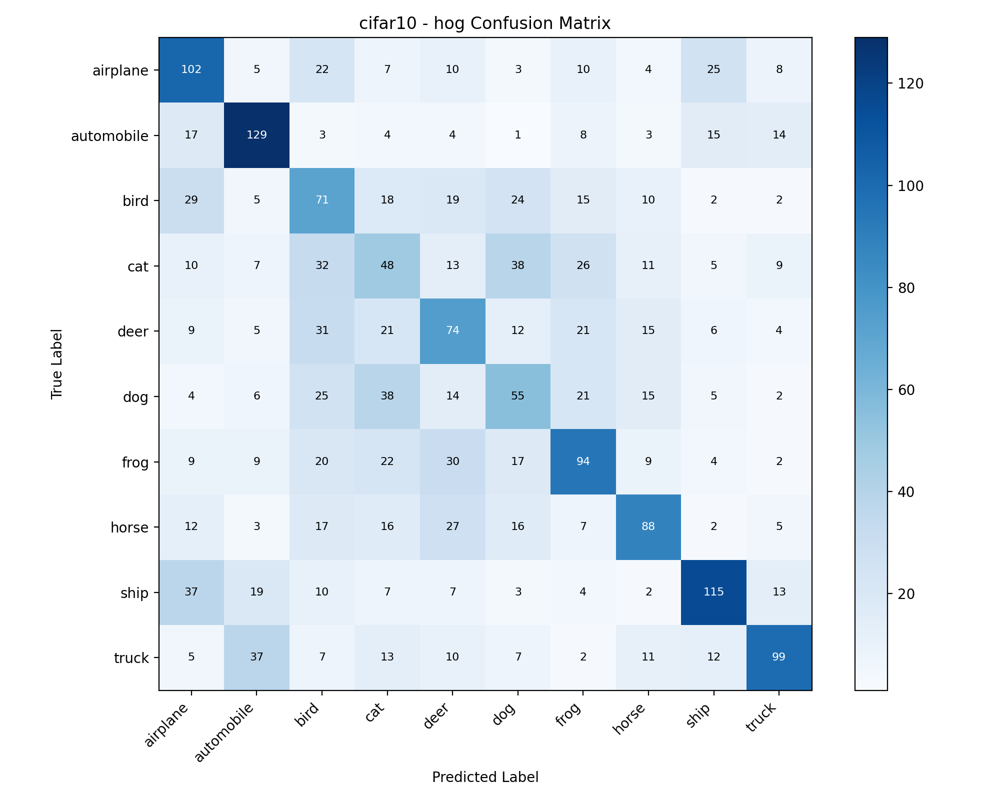 | 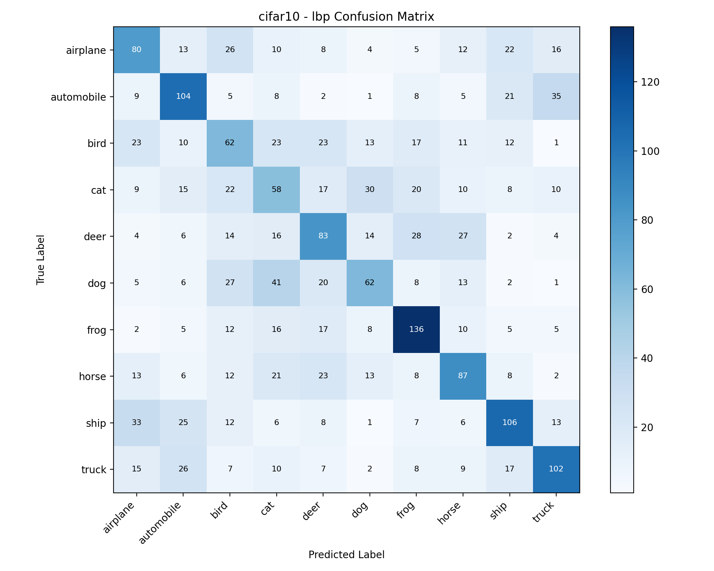 |

</div>

#### Detaylı Gözlemler:
1. **Ham Piksel Yaklaşımının Çöküşü:** Ham piksel doğruluğu **%23.90** düzeyine gerilemiştir (10 sınıflı rastgele tahmin %10'dur). Arka plan karmaşası ve açı değişimlerine karşı toleransı olmayan ham piksel gösterimi, doğal sahnelerde doğrusal ayrılabilirlik sağlayamamaktadır.
2. **HOG ve LBP Dengesi:** HOG (%43.75) ve LBP (%44.00) neredeyse tamamen eşit sonuç vermiştir. Doğal nesneler hem kontur/kenar (tekerlek, gövde, kanat) hem de doku (kürk, tüy, zemin) unsurlarını aynı anda barındırdığından, tek başına hiçbir klasik öznitelik tek başına hakimiyet kuramamaktadır.
3. **Yoğun Sınıf İçi Karışıklık:**
   - Dört ayaklı memeliler (`kedi` $\leftrightarrow$ `köpek` $\leftrightarrow$ `geyik` $\leftrightarrow$ `at`) kendi aralarında yoğun biçimde karışmıştır.
   - Taşıtlar (`otomobil` $\leftrightarrow$ `kamyon`, `uçak` $\leftrightarrow$ `gemi`) hayvanlardan belirgin biçimde ayrışsa da perspektif çeşitliliği nedeniyle kendi içlerinde hata üretmiştir.

---

### 6.4 KTH-TIPS Performansı ve Hata Analizi

<div align="center">

| Doğruluk Karşılaştırması | Makro F1 Karşılaştırması |
|:---:|:---:|
| 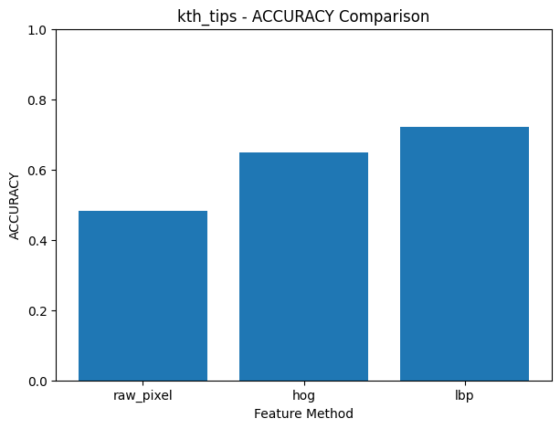 | 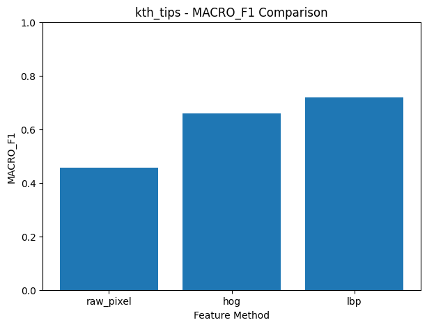 |

</div>

#### Hata Matrisi İncelemesi:
<div align="center">

| Ham Piksel | HOG | LBP (Açık Ara Kazanan) |
|:---:|:---:|:---:|
| 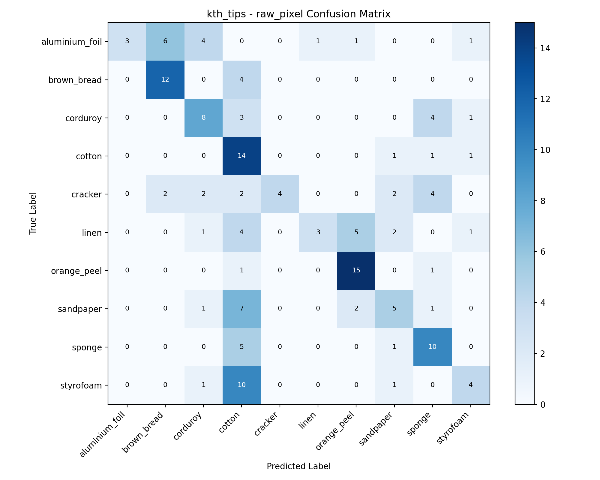 | 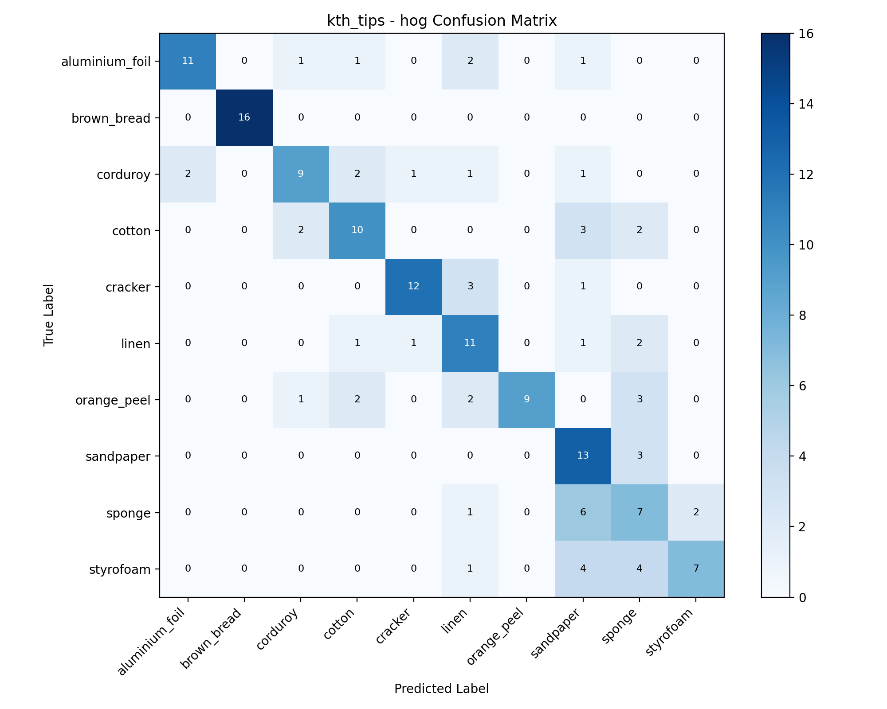 | 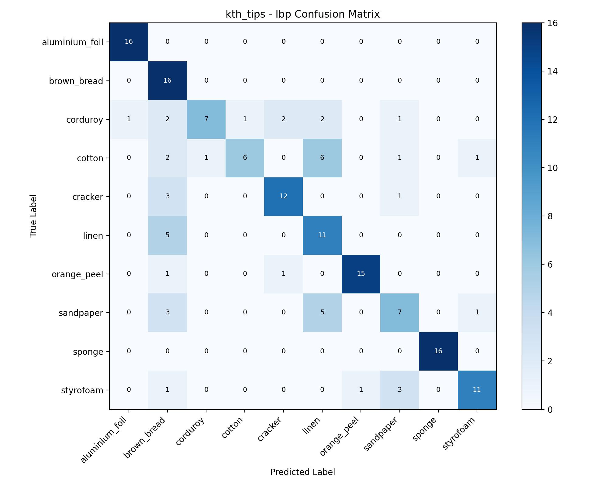 |

</div>

#### Detaylı Gözlemler:
1. **LBP'nin Açık Üstünlüğü:** Çok Ölçekli Mekansal LBP, **%72.22 doğruluk** elde ederek HOG'a **+%7.41**, Ham Piksele ise **+%24.07** fark atmıştır.
2. **Dokuya Özel Temsil Kabiliyeti:** Fitilli kadife, zımpara kağıdı veya sünger gibi malzemeler belirli bir dış sınıra sahip değildir. Ayrım, yüzeydeki mikro gözeneklerin ve parlaklık farklarının frekansında saklıdır. Çok ölçekli dairesel LBP ($R \in \{1, 2, 3\}$), bu deseni eksiksiz biçimde yakalamıştır.
3. **Köşegen Netliği:** `kth_tips_lbp_cm.png` incelendiğinde köşegen üzerindeki doğru tahminlerin belirgin parlaklığı ve minimum sınıf sızıntısı açıkça görülmektedir. HOG ve Ham Pikseller ise özellikle pürüzlü malzemeleri (strafor, sünger, ekmek yüzeyi) ayırt etmekte ciddi güçlük çekmiştir.

---

## 7. Boyutsallık vs. Performans Dengesi (Verimlilik Analizi)

Gerçek zamanlı ve gömülü bilgisayarlı görme sistemlerinde **vektör boyutu, bellek tüketimi ve işlem karmaşıklığı** hayati önem taşır. 

KTH-TIPS deneyleri, bu bağlamda literatür açısından son derece çarpıcı bir mühendislik tablosu ortaya koymuştur:

| Yöntem | Doğruluk | Vektör Boyutu | 1.000 Örnek İçin Bellek | 1.000 Boyut Başına Doğruluk |
|:---|:---:|:---:|:---:|:---:|
| **HOG** | %64.81 | **34.596** | ~138.4 MB (float32) | %1.87 |
| **MS-S-LBP** | **%72.22** | **864** | **~3.45 MB** (float32) | **%83.58** |
| *Verimlilik Kazancı* | **+%7.41** | **40 Kat Tasarruf** | **40 Kat Düşük Bellek** | **44.7 Kat Daha Verimli** |

```
KTH-TIPS Üzerinde Vektör Boyutu Karşılaştırması:
HOG:       ======================================== (34.596 boyut) -> Başarı: %64.81
Ham Piksel:=================== (16.384 boyut)                      -> Başarı: %48.15
MS-S-LBP:  = (864 boyut)                                           -> Başarı: %72.22 (ŞAMPİYON)
```

> [!TIP]
> **Kritik Çıkarım:** Daha yüksek boyut, daha yüksek başarı anlamına gelmez. $128 \times 128$ doku görüntülerinde 34.596 boyutlu HOG vektörü üretmek aşırı seyreltik (sparse) bir uzay yaratarak SVM eğitimini yavaşlatmış ve doğruluğu düşürmüştür. Buna karşılık iyi tasarlanmış 864 boyutlu Çok Ölçekli Mekansal LBP, **40 kat daha kompakt** olmasına karşın **en yüksek doğruluğu** vermiştir.

---

## 8. Hipotezler ve Ampirik Bulgular

| Veri Kümesi | Önsel Bilimsel Hipotez | Ampirik Deney Sonucu | Doğrulama Durumu |
|---|---|---|:---:|
| **Fashion-MNIST** | Giyim sınıfları dış hat ve silüetlerle ayrıştığından **HOG** en iyi performansı verecektir. | HOG **%85.80** ile Ham Piksel (%83.05) ve LBP'yi (%85.05) geçmiştir. | **DOĞRULANDI** |
| **CIFAR-10** | Doğal görüntülerde hem kenar hem doku gerektiğinden **HOG ve LBP benzer** sonuç verecek; ham piksel çökecektir. | Ham piksel **%23.90**'a çökmüştür. HOG (**%43.75**) ve LBP (**%44.00**) başa baş kalmıştır ($\Delta = \%0.25$). | **DOĞRULANDI** |
| **KTH-TIPS** | Yüzeyler tamamen dokusal mikro desenlerden oluştuğu için **MS-S-LBP belirgin biçimde üstün** gelecektir. | LBP **%72.22** alarak HOG'a (+%7.41) ve Ham Piksele (+%24.07) fark atmıştır. | **DOĞRULANDI** |

---

## 9. Çıkarımlar ve Gelecek Çalışmalar

### 9.1 Akademik Çıkarımlar
1. **Öznitelik Seçiminde "No Free Lunch":** Bilgisayarlı görmede evrensel bir öznitelik çıkarıcı yoktur. Çıkarıcı seçimi, problemin morfolojik karakterine (şekil odaklı mı, doku odaklı mı) göre yapılmalıdır.
2. **Şekil İçin Kenar Gradyanı (HOG):** Silüetlerin ayırt edici olduğu problemlerde gradyan yönelim histogramları halen güçlü bir çözümdür.
3. **Yüzeyler İçin Çok Ölçekli Mekansal LBP (MS-S-LBP):** Farklı yarıçaplardaki dairesel LBP operatörlerini uzamsal ızgara ile birleştirmek, ışık değişimlerinden etkilenmeyen ve 864 boyutta kalan olağanüstü verimli bir doku tanımlayıcısı sağlar.
4. **Ham Piksel Kullanımının Yetersizliği:** Uzamsal dönüşüm içermeyen pikseller, doğal sahnelerde tamamen çöküş yaşamakta ve dokulu yüzeylerde zayıf kalmaktadır.

### 9.2 Gelecek Çalışmalar (Örüntü Tanıma Yol Haritası)
Bu çalışmada HOG, tüm veri kümelerinde en dengeli ve istikrarlı davranışı sergileyen yöntem olmuştur (Fashion-MNIST: %85.80, CIFAR-10: %43.75, KTH-TIPS: %64.81).
- **Sabit Öznitelik Temsili:** Planlanan Örüntü Tanıma (Pattern Recognition) fazında öznitelik çıkarıcı olarak HOG (veya HOG+LBP bileşimi) sabitlenecektir.
- **Sınıflandırıcı Mimarilerinin Analizi:** Bağımsız değişken sınıflandırma tarafına kaydırılacak; Doğrusal SVM yerine:
  - Çekirdekli Destek Vektör Makineleri (RBF Kernel SVM, Polynomial SVM)
  - Topluluk Öğrenmesi Modelleri (Random Forest, XGBoost)
  - Çok Katmanlı Algılayıcılar (MLP / Yapay Sinir Ağları)
  - Boyut İndirgeme ve Metrik Öğrenme (PCA, LDA, t-SNE)
  karşılaştırmalı olarak analiz edilecektir.

---

## 10. Proje Dizin Yapısı

```
cv-feature-project/
├── .gitignore               # pycache, geçici dosyalar ve ham veri dökümlerini filtreler
├── README.md                # Ana İngilizce akademik dokümantasyon
├── README_TR.md             # Kapsamlı Türkçe akademik dokümantasyon (Bu dosya)
├── requirements.txt         # Gerekli Python kütüphaneleri
├── config.py                # Global hiperparametreler, dizin yolları ve etiketler
├── main.py                  # Tüm deney sürecini uçtan uca başlatan giriş noktası
├── src/
│   ├── __init__.py
│   ├── config.py            # Konfigürasyon köprüsü
│   ├── data_loader.py       # Veri yükleme, gri tonlama, normalizasyon ve bölme
│   ├── features.py          # Ham Piksel, HOG ve Çok Ölçekli Mekansal LBP kodları
│   ├── train_eval.py        # Lineer SVM eğitimi ve çoklu metrik değerlendirmesi
│   ├── visualization.py     # Metrik grafikleri ve hata matrisi ısı haritaları üretimi
│   └── experiments.py       # 9 kombinasyonu koşturan ana deney döngüsü
├── data/
│   └── raw/
│       └── KTH_TIPS/        # KTH-TIPS doku veri kümesi (10 sınıf, 810 görsel)
└── results/
    ├── metrics/
    │   └── summary_results.csv   # Deneylerin kesin sayısal sonuç tablosu
    ├── figures/                  # Karşılaştırmalı çubuk grafikleri (Acc, F1, vb.)
    └── confusion_matrices/       # 9 adet yüksek çözünürlüklü hata matrisi görseli
```

---

## 11. Kurulum ve Yeniden Üretilebilirlik Kılavuzu

### Önkoşullar
- Python 3.10, 3.11, 3.12 veya 3.13
- Git

### 1. Repoyu Klonlayın
```bash
git clone <repository_url>
cd cv-feature-project
```

### 2. Sanal Ortam (Virtual Environment) Oluşturun ve Aktive Edin
```bash
# Windows PowerShell üzerinde:
python -m venv venv
.\venv\Scripts\Activate.ps1

# Linux / macOS üzerinde:
python3 -m venv venv
source venv/bin/activate
```

### 3. Gerekli Kütüphaneleri Yükleyin
```bash
pip install --upgrade pip
pip install -r requirements.txt
```

### 4. Tüm Deneyleri Çalıştırın
Tüm hattı tek bir komutla başlatabilirsiniz:
```bash
python main.py
```

Bu komut otomatik olarak:
1. **Fashion-MNIST**, **CIFAR-10** ve **KTH-TIPS** veri kümelerini yükler ve normalize eder.
2. **Ham Piksel**, **HOG** ve **Çok Ölçekli Mekansal LBP** özniteliklerini çıkarır.
3. 9 deney kombinasyonunun tamamında Lineer SVM sınıflandırıcılarını eğitir.
4. Doğruluk, kesinlik, duyarlılık ve F1 skorlarını hesaplar.
5. `results/metrics/summary_results.csv` dosyasını günceller.
6. `results/figures/` altına 12 adet karşılaştırma çubuğu grafiği çizer.
7. `results/confusion_matrices/` altına 9 adet hata matrisi kaydeder.

---

## 12. Akademik Atıf ve Lisans

### Müelliflik Bilgisi
Bu proje ve projeye ait tüm algoritmik geliştirmeler, deney tasarımları ve analizler **Ersin Sandal (Bilgisayar Mühendisi)** tarafından bireysel olarak gerçekleştirilmiştir.

### Lisans
Bu proje **MIT Lisansı** ile lisanslanmıştır - ayrıntılar için [LICENSE](LICENSE) dosyasına göz atabilirsiniz.
